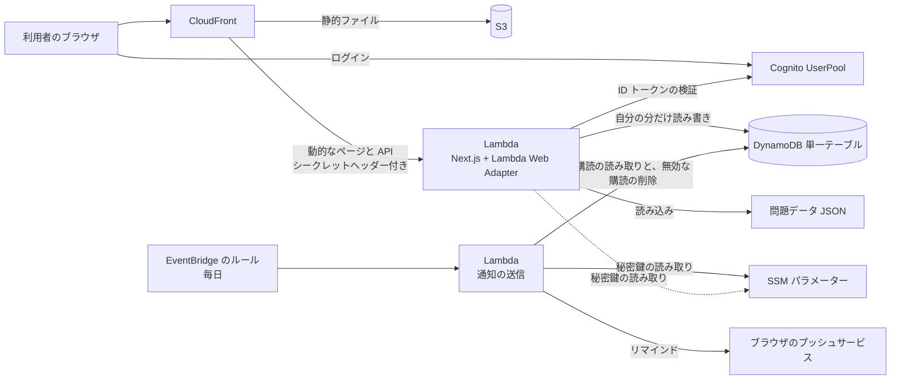

# アーキテクチャの計画

構成の全体像です。実装の前に共有するための計画で、実装に合わせて更新します。判断の理由と、採用しなかった選択肢は、
[ADR](./adr/README.md) に書き、ここからリンクします。

## 全体像

## 構成要素

| 要素 | 役割 | 実装する版(目安) |
| --- | --- | --- |
| 画面(`packages/app`) | 資格の一覧、モード選択、出題、採点、結果、復習、ダッシュボードなど | v0.5.0 以降 |
| API(`packages/app` の API ルート) | 学習履歴の保存と取得、管理者の操作 | v0.12.0 以降 |
| 認証 | Cognito UserPool のみ。セルフサインアップ(確認コードで確かめる)、利用者自身による退会、管理者グループ | v0.9.0 以降(セルフサインアップは v0.76.0 以降) |
| データ | 学習履歴は DynamoDB の単一テーブル。問題データは、リポジトリの静的な JSON | v0.3.0(問題データ)、v0.12.0(履歴) |
| ホスティング | Lambda Web Adapter + CloudFront + S3 | v0.9.0 以降 |
| 通知の送信(`<接頭辞>-push`) | 毎日、購読している端末へ学習のリマインドを送る。通知の設定をそろえたときだけ作る。詳細は [インフラの構築とデプロイ](./infra.md) | v0.23.0 以降 |
| 費用の予算(`<接頭辞>-budget`) | 共通のタグで絞った月の費用が予算を超えそうなときに、メールで知らせる。予算の設定をそろえたときだけ作る。詳細は [インフラの構築とデプロイ](./infra.md) | v0.76.0 以降 |
| インフラ(`packages/infra`) | AWS CDK(TypeScript)。デプロイは `cdkd`。手順は [インフラの構築とデプロイ](./infra.md) | v0.9.0 以降 |

## 主な方針

- **認証**: サーバー側で ID トークンを検証し、そこから取り出した `sub` で、自分の分だけを操作します。
  クライアントから渡された利用者 ID は信用しません。
- **データ**: DynamoDB の単一テーブルで、`PK=USER#{sub}`、`SK` で種別を分けます。アクセスパターンは、実装の前に文書にします。
- **配信**: Lambda の Function URL は `authType: NONE` とし、CloudFront からのリクエストだけを、シークレットヘッダーで受け付けます。
  ヘッダーの値は、リポジトリに置きません。
- **問題データ**: 資格ごとの JSON。形は [問題データの仕様](../data-spec.md) に従い、検証スクリプトで機械的に検査します。
- **環境固有の値**: アカウント ID、ドメイン、証明書などは、リポジトリに置きません(`.env` から読みます)。

## 関連する判断(ADR)

判断の一覧は [ADR の一覧](./adr/README.md) にあります。ここには書き写しません。
